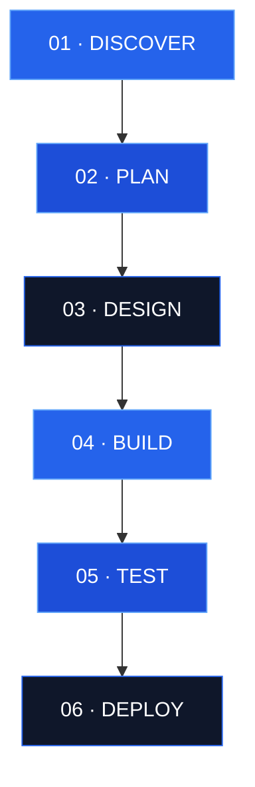

 

---

## ◈ ENTER THE DIGITAL UNIVERSE

**SUDHARSHAN_TECH** is an independent technology initiative focused on building modern digital experiences through software engineering, AI, cloud technologies, and cybersecurity.

*Think boldly. Engineer intelligently. Build responsibly.*

---

## ⚡ OUR TECHNOLOGY MATRIX

| 🌐 Web Engineering | 🤖 AI & Automation | ☁️ Cloud & DevOps | 🛡️ Cybersecurity |
|:---:|:---:|:---:|:---:|
| Modern Interfaces | Intelligent Prototypes | Deployment Workflows | Secure Development |
| Responsive Design | Workflow Automation | Containerization | Application Protection |

---

## ◈ CINEMATIC PROJECT SHOWCASE

### 01 / TECHNICO
**Product & Business Web Experience**

A digital project focused on presenting product and business information through a modern web experience.

`WEB DEVELOPMENT` `UI/UX`

### 02 / TaskGuard
**Enterprise Project Task Management**

A project focused on task organization, progress tracking, and structured workflows.

`SOFTWARE ENGINEERING` `TASK MANAGEMENT`

### 03 / AI Invigilation Engine
**AI-Powered Examination Prototype**

Exploring AI-assisted examination monitoring and computer-vision concepts.

`ARTIFICIAL INTELLIGENCE` `COMPUTER VISION`

### 04 / Virtual Air Painting
**Gesture-Based Creative Interaction**

An interactive project exploring virtual drawing through hand gestures and computer vision.

`PYTHON` `COMPUTER VISION`

### 05 / CineStream
**Digital Entertainment Experience**

A streaming-style project focused on content presentation and interface design.

`FRONTEND` `UI/UX`

### 06 / NIDHI SETU
**Civic Technology Prototype**

A concept for helping users discover relevant government assistance schemes and development opportunities.

`CIVIC TECH` `INFORMATION DISCOVERY`

> Project categories describe their intended focus. Check the individual repositories for implementation details, current status, and available demos.

---

## ◈ VISUAL ENGINEERING DASHBOARD

Illustrative category visualization — equal segments do not represent measured skill levels or project distribution.

 

---

## ◈ GITHUB PERFORMANCE CENTER

 

 

---

## ◈ THE ENGINEERING LIFECYCLE

---

## ◈ LEADERSHIP & COLLABORATION

### Sudharshan P.S.
**Founder & CEO**

*"Turning ideas into impactful digital solutions."*

### Harini R
**Business Development & Partnerships Associate**

*"Connecting opportunities. Creating impact."*

---

## ◈ CONNECT WITH US

 

**SUDHARSHAN_TECH**  
*Code. Create. Elevate.*

Coimbatore, Tamil Nadu, India

ENGINEERED WITH PURPOSE · DESIGNED FOR IMPACT

